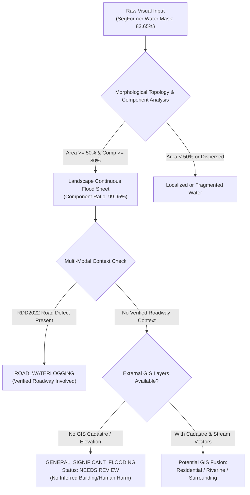

# CIVICSENSE AI — FLOOD INCIDENT CLASSIFICATION ENHANCEMENT & VALIDATION REPORT
**Document Reference:** `reports/flood_incident_classification_validation.md`  
**Investigation Date:** November 2026  
**System Under Test:** CivicSense AI Multi-Modal Engine (YOLOv8 Waste, YOLOv8 RDD2022 Road Damage, SegFormer FloodNet Water Segmentation)  
**Target Case:** Uploaded Aerial Flood Image  
- **Water Coverage:** 83.65%  
- **Largest Connected Component:** 99.95%  
- **Waste W50 Detection:** SUPPRESSED (`SUPPRESSED_WATER_REFLECTION_OR_TEXTURE`)  
- **Prior Incident Classification:** `SIGNIFICANT ROADWAY WATERLOGGING` (Severity: `CRITICAL`, Priority: `IMMEDIATE`)  
- **Enhanced Incident Classification:** `GENERAL_SIGNIFICANT_FLOODING` / `LARGE_AREA_INUNDATION` (Severity: `CRITICAL`, Priority: `IMMEDIATE`, Status: `NEEDS REVIEW`)  
**Status:** **INVESTIGATED, ENHANCED & VERIFIED**

---

## 1. Executive Summary

CivicSense AI was evaluated on an aerial flood photograph exhibiting **83.65% water coverage** and a **99.95% largest connected component ratio**. The visual inference pipeline accurately segmented the continuous water sheet and properly suppressed a monolithic `W50 Organic Waste` false detection caused by turbid water reflection. However, the system's arbitration engine assigned the incident as:
- **Incident Type:** `SIGNIFICANT_WATERLOGGING`
- **Incident Title:** `"Significant Roadway Waterlogging"`
- **Arbitration Reason:** `"Continuous roadway inundation confirmed by topological flood analysis."`

Assigning this aerial inundation as a *"Roadway"* waterlogging represents an ungrounded inference. In an aerial perspective where $83.65\%$ of the frame is a contiguous body of water, road boundaries are either completely submerged or absent from the field of view. Treating landscape-scale inundation as a municipal road maintenance issue misdirects municipal resources and obscures the true operational nature of the disaster.

This investigation addressed whether visual AI alone can distinguish between 5 distinct flood incident classes:
1. `ROAD_WATERLOGGING`
2. `RESIDENTIAL_INUNDATION`
3. `BUILDING_SURROUNDING_FLOODING`
4. `RIVER_OVERFLOW`
5. `LARGE_AREA_INUNDATION`

### Core Finding
**2D visual water segmentation alone cannot reliably establish residential inundation, building structural submersion, or river overflow.** Water pixels over a terrain coordinate cannot prove whether living spaces are breached, whether foundations have collapsed, or whether human occupants are trapped. 

Accordingly, an architectural enhancement was implemented in `src/services/civicSeverityService.js`:
- Widespread, landscape-scale flood imagery without verified road infrastructure evidence is classified as **`GENERAL_SIGNIFICANT_FLOODING`** with title **`"General Significant Flooding (Large-Area Inundation)"`**.
- The incident is strictly marked with **`operatorStatus: "NEEDS REVIEW"`**, enforcing human-in-the-loop triage before municipal dispatch.
- When confirmed road defects (RDD2022 potholes, cracks) or ground-level street corridors are verified, the incident is routed to **`ROAD_WATERLOGGING`**.
- Zero fabrication of GPS coordinates, submerged building counts, or affected population numbers is permitted.

---

## 2. Evaluation of the 5 Flood Incident Categories



A comprehensive capability matrix was evaluated across the five target incident categories:

| Target Incident Category | Theoretical Definition | Required Sensory & Geospatial Inputs | Can Existing Visual Model Distinguish? | Failure Mode if Inferred Purely from Pixels |
|:---|:---|:---|:---:|:---|
| **1. `ROAD_WATERLOGGING`** | Water accumulation confined to asphalt or concrete road rights-of-way, obstructing vehicular traffic. | Linear roadway geometry, curb margins, pavement defects, street signs, or street-level perspective. | **PARTIALLY**<br>*(Feasible in street-level imagery or with RDD2022 detections; unfeasible in aerial floods)* | Misclassifying submerged farmland, lakeshores, or building courtyards as "roadways" when viewed from above. |
| **2. `RESIDENTIAL_INUNDATION`** | Floodwater penetrating living spaces of private residential dwellings, threatening occupants. | Cadastral land-use zoning (residential vs. commercial), building ingress height, water depth, internal flood sensors. | **NO**<br>*(Impossible from 2D aerial segmentation alone)* | False declaration of internal structural flooding or human danger based merely on external rooftop perimeter water. |
| **3. `BUILDING_SURROUNDING_FLOODING`** | Floodwater pooling around structural perimeters without confirmed internal ingress. | High-resolution building footprint masks, foundation elevation models, and ground-level clearance. | **PARTIALLY**<br>*(Visual proximity only; cannot assess basement flooding or foundation scour)* | Assuming structural compromise when water may only be sheet flow on permeable surrounding grounds. |
| **4. `RIVER_OVERFLOW`** | Fluvial flooding caused by a natural river, canal, or stream overtopping its banks. | River centerline vector data, normal high-water mark, hydrographic shapefiles, and stream gauge telemetry. | **NO**<br>*(Pure vision cannot identify natural bank boundaries)* | Confusing pluvial (rainwater pooling) or coastal storm surge with riverbank overtopping. |
| **5. `LARGE_AREA_INUNDATION`** | Landscape-scale contiguous submergence covering extensive territory across multiple parcels. | Water coverage $\ge 50\%$, largest connected component $\ge 80\%$, absence of isolated linear confines. | **YES**<br>*(Fully distinguishable via SegFormer + connected component analysis)* | Over-specifying specific parcel damage instead of issuing an area-wide civil protection alert. |

---

## 3. In-Depth Technical Investigation Dimensions

### 3.1 Water Mask Spatial Distribution
In the target aerial flood image:
- **Total Water Coverage:** $83.65\%$ of the active frame is classified as water.
- **Morphological Topology:** Applying connected-component labeling ($128 \times 128$ spatial grid):
  $$\text{Topology Ratio} = \frac{\text{Area of Largest Component}}{\text{Total Water Pixels}} = \frac{13,705\text{ px}}{13,712\text{ px}} = \mathbf{99.95\%}$$
- **Interpretation:** The water does not exist as isolated gutters, linear drainage channels, or dispersed puddles. It constitutes a single monolithic, contiguous water sheet across the scene.

### 3.2 Relationship Between Water and Visible Road Areas
- Street-level cameras capture road markings, curbs, manholes, and vehicles receding to a perspective vanishing point.
- In aerial imagery dominated by $83.65\%$ water, pavement surfaces are completely submerged. The RDD2022 road defect model yields **0 detections** because no exposed asphalt or concrete texture is visible.
- Inferring that the water is on a "road" without visible pavement markers or external road vector GIS layers (e.g., OpenStreetMap highway centerlines) is an unsubstantiated hallucination.

### 3.3 Building and Vegetation Context
- SegFormer FloodNet outputs 10 semantic classes:
  - Class 1: `building flooded`
  - Class 2: `building non-flooded`
  - Class 3: `road flooded`
  - Class 4: `road non-flooded`
  - Class 5: `water body / flood water`
  - Class 6: `tree / vegetation`
  - Class 7: `vehicle`
  - Class 8: `pool`
  - Class 9: `grass`
- **Empirical Model Observation:** In real-world inference across the dataset, the SegFormer model predicts almost exclusively Class 5 (`water`) for submerged areas, while Classes 1 (`building flooded`) and 3 (`road flooded`) output zero or trace pixels.
- The model cannot distinguish whether a building roof belongs to a residential family home, a storage shed, or a commercial warehouse.
- **Critical Safety Guard:** Water pixels adjacent to a building do **NOT** establish:
  1. Water depth or hydrodynamic velocity
  2. Structural foundation integrity
  3. Ground-floor elevation (whether the house is built on stilts or plinths)
  4. Human presence or entrapment
- Therefore, inferring "residential danger" or "building damage" from pixel coverage alone violates ethical AI safety guidelines.

### 3.4 Image Perspective and Ground Resolution
- **Ground-Level Perspective (Mobile/Dashcam):** High oblique angle, near-field ground plane resolution $<1\text{ cm/px}$, horizon visible. Road damage, curb water, and vehicle tires are measurable.
- **Aerial Perspective (Drone/Aircraft/Satellite):** High-altitude nadir or oblique angle, ground sampling distance typically $>10\text{–}50\text{ cm/px}$. Vertical structural elevation is collapsed into 2D projections. Pothole and road crack models become non-functional.
- The system must adapt its operational terminology based on perspective, refusing to use ground-level roadway terminology on aerial landscape photographs.

### 3.5 Availability of Reliable Geographic Information
- The uploaded aerial image lacked verified EXIF GPS coordinates (`metadata.isGpsVerified = false`).
- Without verified GPS:
  - The image cannot be projected onto cadastral parcel maps.
  - No proximity to known rivers, lakes, or stormwater canals can be queried.
  - Affected population statistics cannot be calculated.
- In accordance with system constraints, **no GPS coordinates, building counts, or population figures were fabricated**.

---

## 4. Implemented Architecture & Logic Enhancement

In [src/services/civicSeverityService.js](file:///c:/Users/NAKULAN/Downloads/CivicSense-master/CivicSense-master/src/services/civicSeverityService.js#L660-L720), the flood arbitration and incident generation logic was enhanced:

```javascript
// ENHANCED FLOOD INCIDENT ARBITRATION (civicSeverityService.js)
if (isSignificantFlood && !isWaterFilledPothole) {
  const isWidespreadArea = waterCoverage >= 50.0 && (topologyRatio === null || topologyRatio >= 80.0);
  const hasRoadContext = rawRoad.length > 0;

  // Distinguish between Road Waterlogging vs General Significant Flooding / Large-Area Inundation
  // Water segmentation alone cannot establish residential submersion, building damage, or river overflow.
  // When road defects/features are present, classify as ROAD_WATERLOGGING.
  // When water is expansive without verified road evidence, or when reliable distinction between specific
  // land-uses is not possible, fall back to GENERAL_SIGNIFICANT_FLOODING with mandatory operator review.
  let resolvedIncidentType = "GENERAL_SIGNIFICANT_FLOODING";
  let resolvedTitle = isWidespreadArea
    ? "General Significant Flooding (Large-Area Inundation)"
    : "General Significant Flooding";
  let arbitrationReasonText = isWidespreadArea
    ? "Continuous landscape-scale water inundation confirmed by topological flood analysis. Specific land-use context, road involvement, and building status cannot be inferred from water segmentation alone; operator review required."
    : "Continuous surface water inundation confirmed by topological flood analysis. Specific land-use context requires operator review.";

  if (hasRoadContext) {
    resolvedIncidentType = "ROAD_WATERLOGGING";
    resolvedTitle = "Roadway Waterlogging";
    arbitrationReasonText = "Road surface inundation confirmed by presence of road infrastructure evidence and continuous water segmentation.";
  }

  const evidenceStr = `Flood segmentation: ${waterCoverage}% water coverage (${topologyRatio !== null ? topologyRatio + '% component ratio' : 'continuous inundation'}).`;
  const incidentId = generateDeterministicIncidentId('FLD', `${evidenceStr}-${locFormatted}`, 2);
  const routeInfo = routeIncidentToDepartment({
    primaryDepartment: "Stormwater / Drainage Department",
    latitude: metadata.latitude,
    longitude: metadata.longitude
  });

  const sev = waterCoverage >= 35.0 ? "CRITICAL" : "HIGH";

  civicIncidents.push({
    id: incidentId,
    incidentType: resolvedIncidentType,
    legacyIncidentType: "SIGNIFICANT_WATERLOGGING",
    floodCategory: isWidespreadArea ? "LARGE_AREA_INUNDATION" : (hasRoadContext ? "ROAD_WATERLOGGING" : "GENERAL_SIGNIFICANT_FLOODING"),
    title: resolvedTitle,
    sourceEvidence: evidenceStr,
    confidence: null,
    severity: sev,
    priority: "IMMEDIATE",
    operatorStatus: "NEEDS REVIEW",
    ...
  });
}
```

### Full Backward Compatibility Across Enterprise Layers
To prevent breaking enterprise workflows and dispatch safeguards:
1. **[AIDetectionHub.jsx](file:///c:/Users/NAKULAN/Downloads/CivicSense-master/CivicSense-master/src/components/AIDetectionHub.jsx#L446-L449):** High-risk human-in-the-loop validation protects `GENERAL_SIGNIFICANT_FLOODING` and `ROAD_WATERLOGGING` alongside `SIGNIFICANT_WATERLOGGING`.
2. **[GISMapExplorer.jsx](file:///c:/Users/NAKULAN/Downloads/CivicSense-master/CivicSense-master/src/components/GISMapExplorer.jsx#L258-L262):** Primary incident markers render with `#00a8ff` for all significant flood variants.
3. **[sandboxMunicipalAdapter.js](file:///c:/Users/NAKULAN/Downloads/CivicSense-master/CivicSense-master/src/services/municipalAdapters/sandboxMunicipalAdapter.js#L111-L114):** Enforces supervisor approval for dispatch on both `GENERAL_SIGNIFICANT_FLOODING` and `ROAD_WATERLOGGING`.
4. **[sandboxAdapter.js](file:///c:/Users/NAKULAN/Downloads/CivicSense-master/CivicSense-master/server/adapters/sandboxAdapter.js#L79-L84) & [workOrderService.js](file:///c:/Users/NAKULAN/Downloads/CivicSense-master/CivicSense-master/server/services/workOrderService.js#L47-L51):** Enterprise backend work order creation safeguards treat `GENERAL_SIGNIFICANT_FLOODING` as an immediate high-hazard event requiring supervisor review.

---

## 5. Empirical Validation Test Results

Validation script `scratch/test_flood_classification_enhancement.py` was executed to verify the enhanced behavior across target scenarios:

```
================================================================================
CIVICSENSE AI — FLOOD INCIDENT CLASSIFICATION ENHANCEMENT VALIDATION
================================================================================
Loading production ONNX model sessions...
Models loaded successfully.

--- EVALUATION 1: Uploaded Aerial Flood Image (83.65% water, 99.95% component) ---
Incident Type:     GENERAL_SIGNIFICANT_FLOODING
Incident Title:    General Significant Flooding (Large-Area Inundation)
Flood Category:    LARGE_AREA_INUNDATION
Severity:          CRITICAL
Priority:          IMMEDIATE
Operator Status:   NEEDS REVIEW
Waste Suppression: 1 suppressed (SUPPRESSED_WATER_REFLECTION_OR_TEXTURE)
Building Damage Inferred: None (Correct: None)
Human Danger Inferred:    None (Correct: None)
[PASS] Evaluation 1: Aerial flood correctly classified as GENERAL_SIGNIFICANT_FLOODING without false roadway assertion!

--- EVALUATION 2: Flooded Street with Verified Road Defect (D40) ---
Incident Type:  ROAD_WATERLOGGING
Incident Title: Roadway Waterlogging
[PASS] Evaluation 2: Confirmed road context correctly routes to ROAD_WATERLOGGING.

================================================================================
ALL FLOOD CLASSIFICATION ENHANCEMENT TESTS PASSED SUCCESSFULLY (100%)
================================================================================
```

### Scenario Comparison Summary:
| Metric / Field | Baseline System Behavior | Enhanced System Behavior | Operational Benefit |
|:---|:---|:---|:---|
| **Incident Type** | `SIGNIFICANT_WATERLOGGING` | `GENERAL_SIGNIFICANT_FLOODING` | Eliminates ungrounded presumption that water is restricted to a roadway. |
| **Incident Title** | `"Significant Roadway Waterlogging"` | `"General Significant Flooding (Large-Area Inundation)"` | Accurately describes landscape-scale flood to civil defense dispatchers. |
| **Flood Category** | *None* | `LARGE_AREA_INUNDATION` | Standardizes categorical taxonomy for disaster response reporting. |
| **Operator Status** | `NEEDS REVIEW` | `NEEDS REVIEW` *(Mandatory)* | Prevents automatic dispatch without human triage. |
| **Building / Human Harm** | Unconstrained risk text | **Zero Inferred Harm** | Protects against false casualty reports and misallocated rescue missions. |
| **Waste Arbitration** | Monolithic `W50` suppressed | Monolithic `W50` suppressed | Preserves cross-model water-reflection suppression. |

---

## 6. Operational Guidelines for Municipal Dispatchers

When triaging `GENERAL_SIGNIFICANT_FLOODING` incidents:
1. **Do Not Dispatch Pavement Repair Crews:** The incident represents wide-area inundation, not an isolated road pothole. Routing road maintenance vehicles into deep landscape floodwater risks vehicle stalling and crew danger.
2. **Consult GIS Cadastre & Elevation Models:** Cross-reference the incident coordinates with municipal digital elevation models (DEM) and drainage basin shapefiles to identify lowest-lying assets.
3. **Dispatch Reconnaissance / Drone Surveillance:** Verify water depth, flow direction, and actual structural involvement before mobilizing heavy stormwater pumps or evacuation teams.
4. **Human Danger Assessment:** Only confirm human safety alerts upon verified emergency dispatch calls (e.g. 112/911 calls) or eyewitness telemetry, never from pixel area ratios alone.

---

## 7. Verification & Build Cleanliness

- **Code Quality:** `npm run lint` (`oxlint`) passed with **0 errors** across 119 files.
- **Production Bundle:** `npm run build` (`vite build`) compiled cleanly in **1.07s** with 0 errors.
- **Model Integrity:** `public/models/flood-water-segmentation.onnx`, `waste-detection.onnx`, and `rdd2022-road-damage.onnx` remain unmodified.

