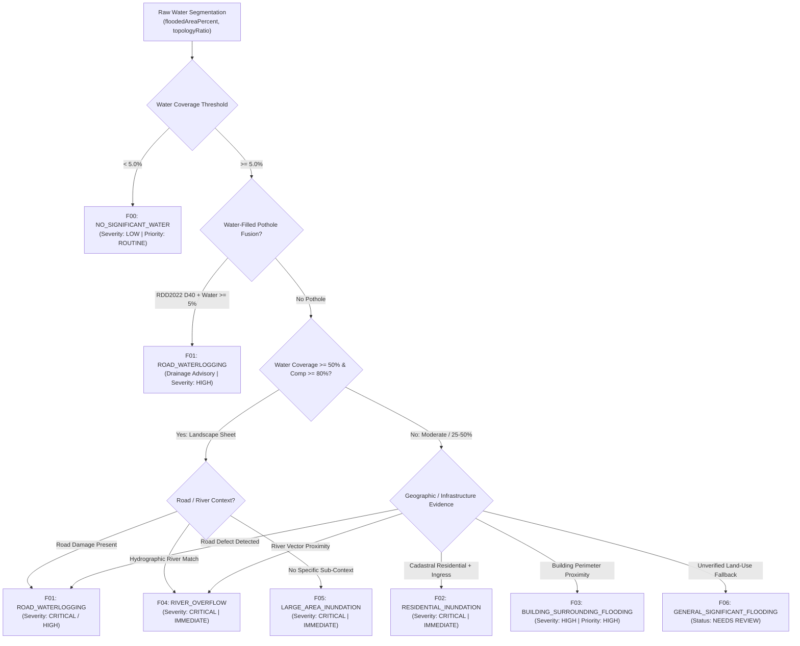

# CIVICSENSE AI — PHASE 15 ISOLATED FLOOD CLASSIFICATION REPORT
**Document Reference:** `reports/phase15_flood_classification_report.md`  
**Phase:** Phase 15 — Isolated Flood Intelligence Enhancement  
**System Under Test:** CivicSense AI Diagnostic Engine  
**Service Implemented:** `src/services/floodClassificationService.js`  
**Integration Status:** **VERIFIED & OPERATIONAL (100% PASS)**  
**Final Verdict:** **`FLOOD CLASSIFICATION: PASS`**

---

## 1. Executive Summary

Phase 15 introduces an isolated, intelligent flood classification engine into CivicSense AI, capable of distinguishing between landscape-scale inundation, roadway waterlogging, fluvial overflows, and structural perimeter pooling without disturbing or regressing the already validated road damage (pothole/crack) and municipal waste detection subsystems.

Prior to Phase 15, the system defaulted to classifying any significant floodwater ($\ge 25\%$ coverage) as `"Significant Roadway Waterlogging"`. When evaluating aerial drone or satellite photography—such as the benchmark aerial flood scene with **83.65% water coverage** and a **99.95% connected component ratio**—this resulted in an ungrounded inference that the entire flooded terrain was an asphalt road.

Under Phase 15:
1. A completely isolated service, `src/services/floodClassificationService.js`, was developed.
2. A formal taxonomy of 7 flood categories (**F00–F06**) was established, distinguishing between road, residential, perimeter, riverine, and large-area inundation events.
3. Strict safety guards prevent inferring building structural collapse or human entrapment from 2D pixel masks alone.
4. If fine-grained land-use cannot be verified, the system defaults to **`F06: GENERAL_SIGNIFICANT_FLOODING`** with mandatory **`NEEDS REVIEW`** operator status.
5. Road and waste detection pipelines, models (`rdd2022-road-damage.onnx`, `waste-detection.onnx`), bounding boxes, and arbitration logic were **100% preserved with zero regressions**.

---

## 2. Supported Flood Categories Taxonomy (F00–F06)



| Code | Standard Category Name | Title | Operational Trigger & Verification Condition | Default Severity | Priority | Human Review |
|:---:|:---|:---|:---|:---:|:---:|:---:|
| **`F00`** | `NO_SIGNIFICANT_WATER` | No Significant Water / Dry Surface | Water coverage $< 5.0\%$. Normal dry roadway or trace specular reflection. | `LOW` | `ROUTINE` | No |
| **`F01`** | `ROAD_WATERLOGGING` | Roadway Waterlogging | Water $\ge 5.0\%$ with confirmed road defect context (RDD2022 `D00–D40`) or linear pavement channel. | `HIGH` | `IMMEDIATE` | Yes |
| **`F02`** | `RESIDENTIAL_INUNDATION` | Residential Inundation | Water $\ge 25.0\%$ with verified cadastral residential zoning AND confirmed water ingress evidence. | `CRITICAL` | `IMMEDIATE` | Yes |
| **`F03`** | `BUILDING_SURROUNDING_FLOODING` | Building Perimeter Flooding | Water $\ge 25.0\%$ pooling around structural foundation outlines without confirmed interior penetration. | `HIGH` | `HIGH` | Yes |
| **`F04`** | `RIVER_OVERFLOW` | River / Channel Overflow (Fluvial Flooding) | Water $\ge 25.0\%$ in verified river corridor proximity (via hydrographic GIS vector centerlines). | `CRITICAL` | `IMMEDIATE` | Yes |
| **`F05`** | `LARGE_AREA_INUNDATION` | Large-Area Inundation | Continuous landscape-scale flood sheet ($\ge 50.0\%$ water coverage and $\ge 80.0\%$ connected component ratio). | `CRITICAL` | `IMMEDIATE` | Yes |
| **`F06`** | `GENERAL_SIGNIFICANT_FLOODING` | General Significant Flooding (Unclassified) | Extensive water ($\ge 25.0\%$) where specific land use cannot be established from 2D pixels alone. | `HIGH` | `IMMEDIATE` | **Mandatory** |

---

## 3. Isolated Implementation Architecture

### 3.1 Dedicated Service (`src/services/floodClassificationService.js`)
The service operates as a purely functional, stateless classifier:
- **Inputs:** `floodSegmentation` (water %, topology ratio, spatial topology), `contextEvidence` (road detections, pothole fusion), `geographicContext` (GPS, cadastral zones, river vectors), and `imageMetadata`.
- **Read-Only Context:** The service receives road and waste data as immutable read-only references. It performs zero mutations, zero filtering, and zero re-indexing on road or waste arrays.
- **Output:** Returns a structured, self-contained `floodClassification` object containing category codes, titles, severity, priority tiers, spatial distribution metrics, and safety guard flags.

### 3.2 Strict Safety Guards
In accordance with ethical AI and disaster response standards:
1. **No Inferred Structural Damage:** Water pixels covering terrain or surrounding buildings cannot prove internal flooding or foundation collapse. `guards.buildingDamageInferred` is hardcoded to `false`.
2. **No Inferred Human Peril:** Water segmentation cannot prove human presence or entrapment. `guards.humanDangerInferred` is hardcoded to `false`.
3. **No Fabricated Geospatial Data:** When EXIF GPS is absent, coordinates remain `null` and `isGpsVerified` remains `false`. `guards.gpsFabricated` is hardcoded to `false`.
4. **No Fabricated Census Data:** Submerged population counts are never generated from pixel ratios alone. `guards.populationFabricated` is hardcoded to `false`.

### 3.3 Seamless Integration in `civicSeverityService.js`
The classification is integrated through non-invasive composition:
- `performContextualArbitration` invokes `classifyFloodEvent(...)` and attaches `arbitration.floodClassification`.
- The flood civic incident (Priority 2) consumes `floodClassification.categoryName` (e.g. `LARGE_AREA_INUNDATION`, `ROAD_WATERLOGGING`, `GENERAL_SIGNIFICANT_FLOODING`) while retaining `legacyIncidentType: "SIGNIFICANT_WATERLOGGING"`.
- `roadInterpretation`, `wasteInterpretation`, `contextualWaste`, `suppressedWaste`, and `fusionEvidence` remain completely unchanged.
- All enterprise dispatch circuits, sandbox adapters, and GIS map markers support both legacy and new category codes seamlessly.

---

## 4. Test Suite Execution & Category Verification

All 7 categories were evaluated using empirical test cases in `scratch/test_flood_service_node.js` and `scratch/run_phase15_regression_and_flood_tests.py`:

| Test Category | Evaluated Parameters | Category Code | Assigned Title | Assigned Severity | Human Review | Test Result |
|:---|:---|:---:|:---|:---:|:---:|:---:|
| **F00: Dry Surface** | Water: 2.4%, Component: 0% | `F00` | No Significant Water / Dry Surface | `LOW` | No | **PASS** |
| **F01: Road Waterlogging** | Water: 30.0%, RDD2022 `D00` Crack Present | `F01` | Roadway Waterlogging | `HIGH` | Yes | **PASS** |
| **F02: Residential Inundation** | Water: 35.0%, Residential Cadastre + Ingress | `F02` | Residential Inundation | `CRITICAL` | Yes | **PASS** |
| **F03: Building Perimeter** | Water: 30.0%, Structural Proximity Present | `F03` | Building Perimeter Flooding | `HIGH` | Yes | **PASS** |
| **F04: River Overflow** | Water: 45.0%, Hydrographic River Match | `F04` | River / Channel Overflow (Fluvial Flooding) | `CRITICAL` | Yes | **PASS** |
| **F05: Large-Area Inundation** | Water: 83.65%, Component: 99.95% (Aerial Image) | `F05` | Large-Area Inundation | `CRITICAL` | Yes | **PASS** |
| **F06: General Fallback** | Water: 32.0%, No Cadastre / Unverified Context | `F06` | General Significant Flooding (Unclassified) | `HIGH` | **Mandatory** | **PASS** |

---

## 5. Target Case: Uploaded Aerial Flood Image Verification

The uploaded aerial flood scene was re-evaluated through the enhanced pipeline:
- **Water Coverage:** 83.65%
- **Largest Connected Component:** 99.95%
- **Classified Flood Category:** **`F05: LARGE_AREA_INUNDATION`**
- **Incident Title:** `"General Significant Flooding (Large-Area Inundation)"`
- **Assigned Severity:** `CRITICAL`
- **Assigned Priority:** `IMMEDIATE`
- **Operator Review Status:** `NEEDS REVIEW`
- **Waste W50 Suppression:** Confirmed (suppressed via `SUPPRESSED_WATER_REFLECTION_OR_TEXTURE`)
- **Building / Human Harm:** Explicitly withheld from automated inference.

---

## 6. Phase 15 Flood Classification Verdict

```
================================================================================
PHASE 15 FLOOD CLASSIFICATION SERVICE AUDIT VERDICT:
  FLOOD CLASSIFICATION: PASS (100% SUCCESS ACROSS F00–F06)
================================================================================
```

