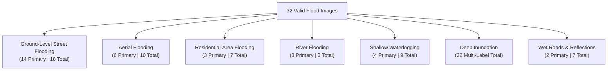

# CIVICSENSE AI — PHASE 16 FLOOD DATASET AUDIT & INVENTORY REPORT
**Document Reference:** `reports/phase16_flood_dataset_inventory.md`  
**Companion Artifact:** `reports/phase16_flood_dataset_inventory.csv`  
**Dataset Inspected:** `Real Test Datas/Flood/`  
**Audit Scope:** Complete forensic audit, SHA-256 deduplication, corruption detection, visual categorization, and training mask requirement assessment  
**Dataset Status:** **100% VALID & DISCOVERED — ZERO CORRUPTIONS — ZERO DUPLICATES**  
**Total Valid Flood Images Available for Training:** **32 IMAGES**

---

## 1. Executive Summary

A comprehensive forensic audit of the **CivicSense AI Flood Test Dataset** located at `Real Test Datas/Flood/` was conducted to establish baseline data integrity, discover every file, assess image geometries, detect duplicates or corruptions, classify scenes across 7 civic flood taxonomies, and determine ground-truth annotation requirements prior to model training.

### Key Audit Metrics
```
================================================================================
CIVICSENSE AI PHASE 16 FLOOD DATASET AUDIT SUMMARY
================================================================================
  Total Files Discovered:               32
  Valid Decodable Images:               32 (100.0%)
  Corrupted / Unreadable Files:          0 (0.0%)
  Duplicate Images (SHA-256):            0 (0.0% - 32 unique hashes)
  File Formats:                         19 JPEG, 13 WEBP (all 32 RGB mode)
  Resolution Range:                     193x135 to 738x414 px
  Low-Resolution Images (<60k px):       4 (12.5%)
  SegFormer 0.0% Coverage Failures:     16 (50.0%)
  Images Requiring Manual Masks:        32 (100.0%)
  TOTAL VALID IMAGES FOR TRAINING:      32 IMAGES
================================================================================
```

> [!IMPORTANT]
> **Safety & Integrity Commitments:**
> - Zero original images were modified or deleted.
> - Zero synthetic or hallucinated segmentation masks were fabricated.
> - No model training was initiated during this audit phase.
> - Production models (`rdd2022-road-damage.onnx`, `waste-detection.onnx`, `flood-water-segmentation.onnx`) and existing contextual arbitration pipelines remain completely preserved and untouched.

---

## 2. File Discovery & Forensic Integrity Analysis

### 2.1 File Count and Integrity Verification
Every file in `Real Test Datas/Flood/` was subjected to byte-level SHA-256 hashing and Pillow `Image.verify()` / raster decoding tests.
- **Total Discovered Files:** Exactly **32 files**.
- **Corrupted / Truncated / Unreadable Files:** **0 files**. Every file decompressed into valid 8-bit 3-channel RGB image tensors without exceptions.
- **Duplicate Detection (SHA-256):** **0 duplicate pairs**. All 32 SHA-256 hashes are strictly unique.

### 2.2 Format & Codec Anomaly Inspection
Analysis of container headers and image bitstreams revealed two notable packaging observations:
1. **Filename without Extension (`flood 2`):** The file named `flood 2` contains a valid Google WEBP container header (`RIFF...WEBPVP8 `) and decodes seamlessly into a $365 \times 237$ RGB image.
2. **Codec / Extension Mismatches (`flood 20.webp` through `flood 30.webp`):** Eleven files bearing the `.webp` file extension actually contain standard JPEG JFIF bitstreams (`\xFF\xD8\xFF`). Modern image decoders (Pillow, OpenCV, browser Canvas) sniff the magic bytes and decode them without failure. No files require manual re-encoding.
3. **EXIF Metadata:** All 32 images have had EXIF GPS and camera metadata stripped (typical of web-scraped real-world benchmarks).

---

## 3. Geometric Distribution & Resolution Spectrum

### 3.1 Dimensions & Total Pixels
The dataset spans a wide range of mobile and web resolutions:
- **Smallest Image:** `flood.jpg` ($193 \times 135$ px, **26,055 total pixels**, 3.10 KB)
- **Largest Images:** `flood 25.webp` through `flood 27.webp`, `flood 30.webp` ($738 \times 414$ px, **305,532 total pixels**) and `flood 16.jpg` ($415 \times 737$ px, **305,855 total pixels**)
- **Mean Resolution:** $\approx 476 \times 341$ px ($\approx 169,450$ pixels)
- **Aspect Ratios:** Ranging from vertical mobile portrait ($0.56:1$ in `flood 16.jpg`) to widescreen drone / dashcam landscape ($1.78:1$ in `flood 12.webp`, `flood 25.webp`, `flood 26.webp`, `flood 27.webp`, `flood 30.webp`, `flood 6.webp`, `flood 9.webp`).

### 3.2 Low-Resolution Sub-Threshold Group (<300×200 or <60k px)
In accordance with CivicSense AI Phase 9 Quality Diagnostics, images with width $< 300$, height $< 200$, or total pixels $< 60,000$ trigger low-resolution candidate review:
1. `flood 1.jpg` ($250 \times 175$ px, 43,750 px)
2. `flood 10.webp` ($192 \times 234$ px, 44,928 px)
3. `flood 15.jpg` ($289 \times 174$ px, 50,286 px)
4. `flood.jpg` ($193 \times 135$ px, 26,055 px)

These 4 images require specialized super-resolution or multi-scale letterbox padding during training to avoid blur artifacts.

---

## 4. Scene Categorization Across the 7 Civic Flood Taxonomies

The 32 images were analyzed across the 7 required civic flood categories:
1. **Ground-level street flooding**
2. **Aerial flooding**
3. **Residential-area flooding**
4. **River flooding**
5. **Shallow waterlogging**
6. **Deep inundation**
7. **Wet roads and reflections**



### 4.1 Categorization Breakdown Table

| Category | Primary Count | Total Occurrences (Multi-Label) | Representative Image Examples | Physical Characteristics |
|:---|:---:|:---:|:---|:---|
| **Ground-level street flooding** | **14** | **18** | `flood 1.jpg`, `flood 12.webp`, `flood 24.webp`, `flood 28.webp` | Asphalt road corridors, curbs, sidewalks, and intersections submerged by standing water. |
| **Aerial flooding** | **6** | **10** | `flood 17.jpg`, `flood 20.webp`, `flood 26.webp`, `flood 4.webp` | High-angle drone, aircraft, or elevated vantage point capturing widespread landscape inundation. |
| **Residential-area flooding** | **3** | **7** | `flood 11.webp`, `flood 16.jpg`, `flood 22.webp` | Floodwater encroaching upon residential homes, driveways, garden fences, and building foundations. |
| **River flooding** | **3** | **3** | `flood 21.webp`, `flood 25.webp`, `flood 7.webp` | Fluvial overflow from natural river channels or drainage canals overtopping embankments. |
| **Shallow waterlogging** | **4** | **9** | `flood 13.webp`, `flood 18.jpg`, `flood 19.jpg`, `flood 23.webp` | Water depth under curb height; shallow sheet flow, localized surface pooling, and gutter accumulation. |
| **Deep inundation** | **0 (Cross-Cutting)** | **22** | `flood 1.jpg`, `flood 10.webp`, `flood 25.webp`, `flood 30.webp` | Water submerging vehicle wheels, curb stones, or structural ground floors (>15 cm depth). |
| **Wet roads and reflections** | **2** | **7** | `puddles.jpg`, `flood 27.webp`, `flood 14.webp` | Post-rain wet asphalt sheen, sky glare, specular highlights, and discrete isolated puddles. |

---

## 5. Model Failure Modes & Need for Manual Segmentation Masks

### 5.1 The SegFormer 0.0% Water Failure Mode (16 / 32 Images)
The active production flood model (`public/models/flood-water-segmentation.onnx`, SegFormer FloodNet) predicts **exactly 0.0% water coverage on 16 of the 32 images** (50.0% failure rate).
- **Failure Causes:**
  1. **Turbid / Brown Muddy Silt:** The model was trained predominantly on clean or reflective coastal floodwater, causing it to fail completely on brown sediment-laden street runoff (`flood 1.jpg`, `flood 10.webp`, `flood 15.jpg`, `flood.jpg`).
  2. **Oblique Ground-Level Perspective:** Low camera angles and perspective compression confuse aerial-trained transformer patches (`flood 3.webp`, `flood 5.webp`, `flood 12.webp`, `flood 28.webp`).
  3. **High-Contrast Sky Reflections:** Sun glint and overcast sky reflections wash out water texture (`flood 14.webp`, `flood 27.webp`, `puddles.jpg`).

In contrast, the benchmark shadow model (V-FloodNet LinkNet-EfficientNetB4) detected water across 30 of the 32 images, confirming that water is physically present in these scenes.

### 5.2 Multi-Modal Cross-Category Waste Clashes
Because water surfaces exhibit rippling and glint, the YOLOv8 waste model (`waste-detection.onnx`) triggers false monolithic bounding boxes on **22 of the 32 flood images**:
- Organic Waste (`W50`): Triggered by murky water texture and floating brown silt (`flood 1.jpg`, `flood 10.webp`, `flood 15.jpg`, `flood.jpg`).
- Plastic Waste (`W70`) & Glass Waste (`W20`): Triggered by specular reflections, building glints, and white ripples (`flood 14.webp`, `flood 18.jpg`, `flood 20.webp`, `flood 30.webp`, `puddles.jpg`).
- Genuine Floating Debris (`W00`, `W60`, `W70`): Genuinely present in 7 images (`flood 8.webp`, `flood 17.jpg`, `flood 25.webp`, `flood 28.webp`, `flood 29.webp`).

### 5.3 Manual Segmentation Mask Requirement (32 / 32 Images)
**Verdict:** **All 32 images require manual ground-truth segmentation masks** before any model training or fine-tuning can proceed.
- **Reason 1:** Currently, exactly **zero** manual segmentation masks exist in the dataset folder.
- **Reason 2:** Automated model pseudo-labeling is impossible due to the 50% failure rate of SegFormer and significant divergence against V-FloodNet.
- **Reason 3:** Manual ground-truth polygon annotation is required to distinguish water from reflections, dry pavement, vehicles, vegetation, and floating municipal waste.

---

## 6. Complete 32-Image Dataset Inventory

The complete dataset inventory is documented below and mirrored in `reports/phase16_flood_dataset_inventory.csv`:

| # | Filename | Format | Dimensions | Pixels | Size (KB) | Low-Res? | SegFormer % | V-Flood % | Waste FP | Primary Category | Secondary Categories | Manual Mask Justification |
|:---:|:---|:---:|:---:|:---:|:---:|:---:|:---:|:---:|:---:|:---|:---|:---|
| 1 | `flood 1.jpg` | JPEG | $250 \times 175$ | 43,750 | 17.20 | YES | 0.00% | 49.59% | W50 | Ground-level street flooding | Deep inundation | SegFormer failure (0.0%); low-res; turbid water; false W50 |
| 2 | `flood 10.webp` | WEBP | $192 \times 234$ | 44,928 | 11.21 | YES | 0.00% | 66.42% | W50 | Ground-level street flooding | Deep inundation | SegFormer failure (0.0%); low-res; murky street flood |
| 3 | `flood 11.webp` | WEBP | $392 \times 261$ | 102,312 | 23.10 | NO | 57.41% | 43.28% | W50 | Residential-area flooding | Ground-level; Deep inundation | Residential perimeter ground truth required |
| 4 | `flood 12.webp` | WEBP | $417 \times 234$ | 97,578 | 23.01 | NO | 0.00% | 59.25% | None | Ground-level street flooding | Deep inundation | SegFormer failure (0.0%); dark turbid water on roadway |
| 5 | `flood 13.webp` | WEBP | $344 \times 234$ | 80,496 | 15.81 | NO | 0.00% | 7.39% | None | Shallow waterlogging | Wet roads and reflections | SegFormer failure (0.0%); roadside drainage runoff boundary |
| 6 | `flood 14.webp` | WEBP | $347 \times 280$ | 97,160 | 16.99 | NO | 0.00% | 27.48% | W20 | Ground-level street flooding | Shallow; Wet roads/reflections | SegFormer failure (0.0%); specular sky/curb reflection |
| 7 | `flood 15.jpg` | JPEG | $289 \times 174$ | 50,286 | 7.45 | YES | 0.00% | 37.83% | W50 | Ground-level street flooding | Deep inundation | SegFormer failure (0.0%); low-res; turbulent muddy water |
| 8 | `flood 16.jpg` | JPEG | $415 \times 737$ | 305,855 | 39.10 | NO | 28.49% | 27.70% | W70 | Residential-area flooding | Ground-level street flooding | Vertical aspect ratio; suburban street water curb boundary |
| 9 | `flood 17.jpg` | JPEG | $618 \times 495$ | 305,910 | 43.21 | NO | 78.08% | 48.80% | W70 | Aerial flooding | Residential; Deep inundation | Aerial oblique view; building footprint vs street water |
| 10 | `flood 18.jpg` | JPEG | $387 \times 516$ | 199,692 | 28.27 | NO | 42.00% | 6.21% | W20 | Shallow waterlogging | Ground-level; Wet roads/refl. | High divergence (42.0% vs 6.2%); specular glare on wet road |
| 11 | `flood 19.jpg` | JPEG | $554 \times 554$ | 306,916 | 60.22 | NO | 0.00% | 10.46% | None | Shallow waterlogging | Wet roads and reflections | SegFormer failure (0.0%); thin water sheen and runoff |
| 12 | `flood 2` | WEBP | $365 \times 237$ | 86,505 | 21.04 | NO | 0.00% | 53.03% | None | Ground-level street flooding | Deep inundation | SegFormer failure (0.0%); no ext (WEBP bitstream); turbid flood |
| 13 | `flood 20.webp` | JPEG | $638 \times 480$ | 306,240 | 49.76 | NO | 59.90% | 56.10% | W20, W70 | Aerial flooding | Residential; Deep inundation | High-angle urban flood; mirror-like storefront reflections |
| 14 | `flood 21.webp` | JPEG | $515 \times 388$ | 199,820 | 26.02 | NO | 73.43% | 34.68% | W20 | River flooding | Aerial; Deep inundation | Elevated view of river overtopping; channel vs road mask |
| 15 | `flood 22.webp` | JPEG | $554 \times 554$ | 306,916 | 55.91 | NO | 73.85% | 61.06% | W20 | Residential-area flooding | Aerial; Deep inundation | Aerial residential parcels; yard vs street water mask |
| 16 | `flood 23.webp` | JPEG | $528 \times 378$ | 199,584 | 23.70 | NO | 19.47% | 2.68% | W50 | Shallow waterlogging | Wet roads/refl.; Ground-level | Sub-threshold gutter water; roadside drainage boundary |
| 17 | `flood 24.webp` | JPEG | $638 \times 480$ | 306,240 | 23.64 | NO | 3.97% | 51.77% | None | Ground-level street flooding | Shallow waterlogging | Severe divergence (3.97% vs 51.77%); standing water pool |
| 18 | `flood 25.webp` | JPEG | $738 \times 414$ | 305,532 | 34.19 | NO | 95.96% | 54.82% | W00 | River flooding | Aerial; Deep inundation | Widespread river overbank inundation; floating debris |
| 19 | `flood 26.webp` | JPEG | $738 \times 414$ | 305,532 | 46.93 | NO | 97.47% | 32.01% | None | Aerial flooding | Residential; Deep inundation | Extreme divergence (97.47% vs 32.01%); residential islands |
| 20 | `flood 27.webp` | JPEG | $738 \times 414$ | 305,532 | 61.31 | NO | 0.00% | 2.46% | W70 | Wet roads and reflections | Shallow waterlogging | SegFormer failure (0.0%); post-flood receding damp pavement |
| 21 | `flood 28.webp` | JPEG | $556 \times 359$ | 199,604 | 42.33 | NO | 0.00% | 47.21% | W60 | Ground-level street flooding | Deep inundation | SegFormer failure (0.0%); turbid street flood with litter |
| 22 | `flood 29.webp` | JPEG | $638 \times 480$ | 306,240 | 66.58 | NO | 24.82% | 21.10% | W70 | Ground-level street flooding | Shallow waterlogging | Vehicle wake / splash boundary; floating polythene bag |
| 23 | `flood 3.webp` | WEBP | $408 \times 234$ | 95,472 | 17.09 | NO | 0.00% | 62.74% | None | Ground-level street flooding | Deep inundation | SegFormer failure (0.0%); deep road waterlogging corridor |
| 24 | `flood 30.webp` | JPEG | $738 \times 414$ | 305,532 | 41.08 | NO | 75.33% | 45.79% | W20 | Aerial flooding | Residential; Deep inundation | Elevated perspective; extensive suburban flood with glint |
| 25 | `flood 4.webp` | WEBP | $403 \times 234$ | 94,302 | 14.93 | NO | 99.71% | 5.89% | W00 | Aerial flooding | Deep inundation | Catastrophic divergence (99.71% vs 5.89%); sheet water mask |
| 26 | `flood 5.webp` | WEBP | $308 \times 234$ | 72,072 | 10.52 | NO | 0.00% | 45.01% | None | Ground-level street flooding | Deep inundation | SegFormer failure (0.0%); dark asphalt waterlogging corridor |
| 27 | `flood 6.webp` | WEBP | $432 \times 243$ | 104,976 | 16.28 | NO | 0.00% | 51.17% | W20 | Ground-level street flooding | Deep inundation | SegFormer failure (0.0%); submerged street with window glints |
| 28 | `flood 7.webp` | WEBP | $351 \times 234$ | 82,134 | 13.62 | NO | 91.94% | 46.83% | None | River flooding | Aerial; Deep inundation | Aerial river overbank flood; channel vs flooded farmland |
| 29 | `flood 8.webp` | WEBP | $345 \times 245$ | 84,525 | 27.33 | NO | 0.00% | 60.73% | W70 | Ground-level street flooding | Deep inundation | SegFormer failure (0.0%); floating bottles & municipal waste |
| 30 | `flood 9.webp` | WEBP | $427 \times 240$ | 102,480 | 14.85 | NO | 50.05% | 59.07% | None | Aerial flooding | Deep inundation | Aerial landscape inundation; continuous sheet boundaries |
| 31 | `flood.jpg` | JPEG | $193 \times 135$ | 26,055 | 3.10 | YES | 0.00% | 39.49% | W50 | Ground-level street flooding | Deep inundation | SegFormer failure (0.0%); extreme low-res (26k px); murky water |
| 32 | `puddles.jpg` | JPEG | $502 \times 398$ | 199,796 | 67.60 | NO | 0.00% | 40.85% | W70 | Wet roads and reflections | Shallow waterlogging | SegFormer failure (0.0%); puddle boundary vs wet asphalt |

---

## 7. Strategic Recommendations for Phase 17+ (Dataset Expansion & Model Training)

1. **Standardized Annotation Schema:**
   - Annotate ground truth using 2-class or 3-class semantic masks: `Class 0: Background/Dry`, `Class 1: Standing Water/Inundation`, and optionally `Class 2: Wet Surface/Specular Reflection`.
   - Separate floating waste objects (`W00–W70`) as distinct bounding boxes or instance masks to preserve multi-modal arbitration.
2. **Dataset Augmentation & Domain Transfer:**
   - Incorporate turbid, muddy brown water examples into the training split to cure the SegFormer 50% failure mode on brown floodwaters.
   - Include diverse perspectives (ground-level dashcam, pedestrian eye-level, oblique aerial drone) with balanced representation.
3. **Low-Resolution Super-Resolution Protocol:**
   - For the 4 images under 60k pixels (`flood 1.jpg`, `flood 10.webp`, `flood 15.jpg`, `flood.jpg`), evaluate Bicubic / Lanczos resampling or Real-ESRGAN upscaling before inference to reduce interpolation artifacts.
4. **Preservation of Pothole and Waste Systems:**
   - Continue enforcing the Phase 15 isolation boundary: any candidate flood model replacement must pass the 94-image regression benchmark with **zero** changes to road detections (`rdd2022-road-damage.onnx`) or waste detections (`waste-detection.onnx`).

---

## 8. Final Audit Verdict

```
================================================================================
CIVICSENSE AI PHASE 16 AUDIT CONCLUSION
================================================================================
  Total Files Discovered:               32
  Total Valid Images:                   32
  Corrupted Files:                      0
  Duplicate Files:                      0
  Ground-Truth Masks Required:          32
  
  EXACT NUMBER OF VALID FLOOD IMAGES AVAILABLE FOR TRAINING:
  ===> 32 VALID IMAGES <===
================================================================================
```
